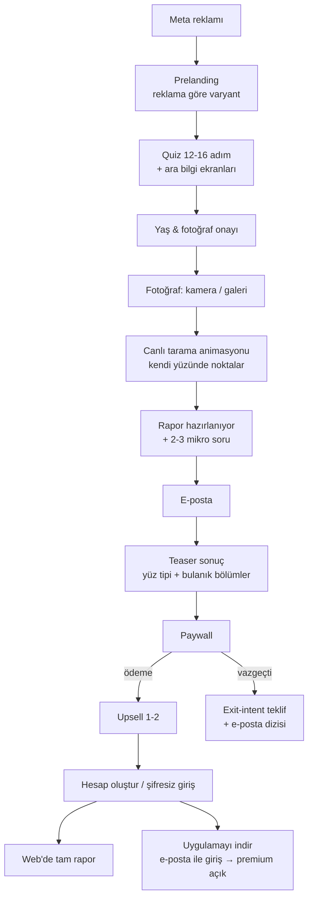
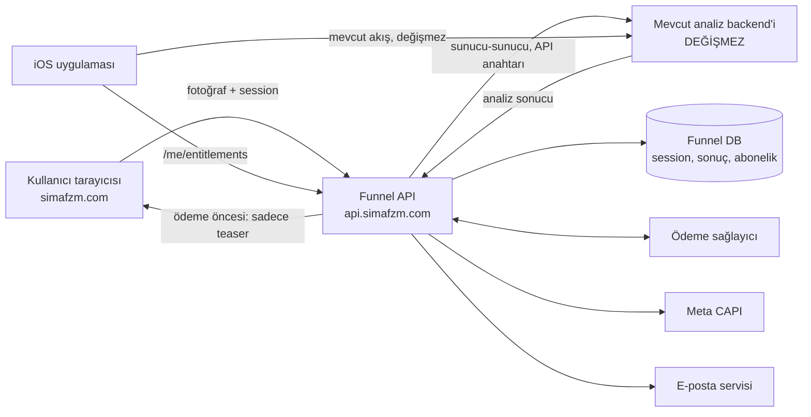

# Sima — Web2App Funnel: Ürün, Monetizasyon ve Geliştirme Planı

> **Amaç:** `simafizyo.vercel.app` adresindeki yalın React demosunu, Meta reklamlarından gelen trafiği ödeme yapan aboneye çeviren, ölçülebilir ve optimize edilebilir bir **web2app satış hunisine (funnel)** dönüştürmek.
> **Kapsam:** Ürün akışı, ekran ekran içerik, fiyatlandırma, uygulama entegrasyonu, takip/atribüsyon, teknik mimari, tasarım, CRM, KPI ve yol haritası. Ödeme altyapısı ve hukuk notları dökümanın sonunda (Bölüm 17–18).
> **Hazırlanma tarihi:** 7 Kasım 2026 · **Güncelleme:** kararlar işlendi (öncelikli pazar Türkiye, RevenueCat yok, mevcut analiz backend'i aynen korunuyor, domain `simafzm.com`)

## 1. Adım: Mevcut durumu incele (henüz kod yazma)
- Mevcut React web demosunu incele: klasör yapısı, kullanılan araçlar (CRA mı, Vite mi), bileşenler, routing.
- Analiz backend'inin nasıl çağrıldığını bul: endpoint URL'i, istek formatı (fotoğraf nasıl gönderiliyor), yanıt JSON'unun yapısı, kimlik doğrulama, hata yanıtları.
- Dökümandaki Bölüm 16 "Açık Sorular"ın 1–6. maddelerini koddan cevaplayabildiğin kadar cevapla:
    - yanıtta yüz noktası/koordinat var mı,
    - özet/arketip alanı var mı,
    - hangi bölümler dönüyor,
    - erişim nasıl korunuyor.
- Bulgularını kısa bir rapor olarak yaz: neyi buldun, neyi bulamadın, bana ne sorman gerekiyor.

## 2. Adım: Uygulama planı (onayımı bekle)
Dökümandaki Faz 1'i küçük, her biri tek başına çalışır ve test edilebilir milestone'lara böl. Önerdiğim sıra:
M1. Next.js (App Router) + TypeScript + Tailwind iskeleti, tasarım token'ları, temel funnel bileşenleri (ProgressBar, OptionCard, StickyCTA, InfoScreen)
M2. JSON config ile çalışan funnel motoru + quiz (Bölüm 4.2, 8.3); session sunucuda tutulsun
M3. Prelanding varyantları (Bölüm 4.1), UTM yakalama
M4. Fotoğraf adımı + görsel ön işleme + /api/analyze proxy'si + tarama animasyonu (Bölüm 4.4, 4.5, 8.5)
M5. Rapor hazırlanıyor + e-posta + teaser sonuç (Bölüm 4.6–4.8)
M6. Paywall + upsell ekranları, ödeme için mock (Bölüm 4.9–4.11)
M7. Welcome + web rapor görüntüleyici (Bölüm 4.12, 4.13)
M8. Pixel + CAPI + analitik eventleri (Bölüm 7)
Planı bana göster, onayımı almadan kodlamaya başlama.

## Kurallar (her adımda geçerli)
- Mevcut analiz backend'ine ve içindeki analiz mantığına DOKUNMA. Tarayıcı backend'i doğrudan çağırmaz; tüm çağrılar funnel API'si üzerinden gider. Ödeme yapılana kadar tarayıcıya sadece teaser alanları döner (Bölüm 8.0, 8.5).
- Fotoğrafı diske yazma, loglama, hata izleme aracına gönderme.
- Ödeme sağlayıcısı entegre etme. PaymentProvider arayüzü + mock implementasyon yeterli; gerçek entegrasyon en sona kalacak (Bölüm 17).
- Hukuk/yasal metin işlerine (Bölüm 18) şimdilik girme.
- Mobil öncelikli, Instagram/Facebook uygulama içi tarayıcısında çalışacak şekilde tasarla (Bölüm 8.8).
- Dil önce Türkçe; tüm metinler çeviri anahtarı olarak dursun, EN sonradan eklenebilsin.
- Quiz soruları, fiyatlar ve deney varyantları koda gömülmesin, config dosyalarından gelsin.
- Her milestone sonunda:
    - nasıl çalıştırıp test edeceğimi yaz,
    - sima-web2app-plan.md içindeki ilgili checkbox'ları işaretle.
- Dökümanla çelişen ya da dökümanda olmayan bir karar gerekirse tahmin etme, bana sor.
---

## 0. Özet (TL;DR)

1. Reklama tıklayan kullanıcı **uygulama indirmeden** web'de: reklamla eşleşen giriş sayfası → 12–16 adımlık kişiselleştirme quiz'i → yüz fotoğrafı + canlı tarama animasyonu ("vay be" anı) → e-posta → bulanık/teaser sonuç → paywall → ödeme → upsell → uygulamayı indir / web'de raporu oku.
2. Yüz analizi **mevcut analiz backend'iyle, hiç değiştirilmeden** yapılır. Arada yeni bir funnel API katmanı (proxy) olur. Bu katman tam sonucu sunucuda tutar ve ödeme yapılana kadar tarayıcıya sadece teaser gönderir; aksi halde tam sonuç tarayıcının ağ sekmesinden okunabilir (Bölüm 8.0, 8.5).
3. Gelir: **düşük ücretli deneme → otomatik yenilenen abonelik** + ödeme sonrası tek tıkla upsell; Türkiye için TL fiyat testleri (Bölüm 5, 13). Ödeme sağlayıcısı ve teknik ödeme altyapısı dökümanın sonunda (Bölüm 17).
4. Takip: Meta Pixel + **Conversions API (sunucu tarafı)**, her funnel adımı için analitik eventi, A/B test altyapısı ilk günden.
5. Uygulama ile köprü: web'de satın alan kullanıcı uygulamaya **e-posta ile giriş (magic link/kod)** yaparak premium'unu açar. RevenueCat olmadığı için abonelik durumu kendi backend'inizde tutulur. Uygulamada IAP aynen kalmaya devam eder.

---

## 1. Mevcut Durum Tespiti

### 1.1 Web demo (`simafizyo.vercel.app`)
- Sayfa başlığı `SimaKIT`, `theme-color #000000`, JS kapalıyken "You need to enable JavaScript" mesajı → büyük olasılıkla **Create React App** tabanlı, tamamen client-side render edilen bir SPA. (Kod tabanını görmedim; bu tespit HTML çıktısına dayanıyor.)
- SEO/OG meta etiketleri, sosyal paylaşım görseli, analitik, pixel, ödeme, onboarding, paywall yok.
- Analiz mantığı ayrı bir backend sunucusunda: istemci fotoğrafı gönderiyor, backend analiz sonucunu dönüyor.
- **Sonuç:** Analiz backend'i ve mevcut analizler **olduğu gibi korunur**. Funnel (ön yüz + oturum/ödeme/takip katmanı) bu backend'in önüne yeni bir katman olarak inşa edilir.

### 1.2 iOS uygulaması (App Store sayfasından)
| Alan | Değer | Funnel için anlamı |
|---|---|---|
| İsim | Simaloji: Face Tracker | Web'de marka adı **Sima / Simaloji** tutarlı olmalı |
| Kategori / Yaş | Entertainment, 18+ | Funnel'da yaş kapısı şart; "eğlence amaçlıdır" ibaresi görünür olmalı |
| Diller | TR, EN, AR, BS | Funnel i18n + Arapça için RTL desteği |
| Özellikler | Günlük yüz takibi, 14 bölge analizi, interaktif yüz haritası (Apple Vision), ikili uyum, keşfet/eğitim içerikleri, arşiv & paylaşım kartları | Paywall'daki "neler dahil" listesinin ham maddesi |
| Gizlilik vaadi | Takip fotoğrafları cihazda kalır; analiz fotoğrafları işlendikten sonra silinir; her analiz öncesi açık onay | **Web funnel bu vaadi bozmamalı** → fotoğraf analizden sonra silinir, sunucuda saklanmaz (Bölüm 8.5.2) |
| IAP fiyatları | Aylık $5.99, Yıllık $49.99 | Web fiyatlandırması bu referansa göre konumlandırılmalı (Bölüm 5) |
| Puan/yorum | Henüz yeterli yorum yok | Funnel'da gerçek sosyal kanıt şu an zayıf → toplama planı gerekli (Bölüm 4.14) |

### 1.3 Alınan kararlar
| Konu | Karar | Dökümana etkisi |
|---|---|---|
| Abonelik altyapısı | RevenueCat yok | Abonelik durumu kendi backend'inizde; iOS uygulaması web aboneliğini backend'den sorgular (Bölüm 6.2) |
| Pazar | Önce Türkiye, başarı sonrası tier-1 | TL fiyat ve Türkiye'ye özel notlar (Bölüm 13); tier-1 hazırlığı (Bölüm 14) |
| Analiz | Mevcut backend ve analizler aynen kullanılacak | Tarayıcıda analiz yok; funnel API proxy + teaser kilidi (Bölüm 8.0, 8.5) |
| Domain | `simafzm.com` | Funnel, API, e-posta, Universal Link ve Meta doğrulaması bu alan adında |

**Marka tutarlılığı notu:** Şu an üç farklı isim var: alan adı `simafzm`, uygulama "Simaloji", web demo başlığı "SimaKIT". Kullanıcı reklamda, funnel'da, banka ekstresinde, e-postada ve App Store'da **aynı ismi** görmeli. Aksi halde güven kaybı ve "bunu tanımıyorum" chargeback'leri artar. Önerim: görünen marka **Simaloji**, alan adı `simafzm.com`, ekstre açıklaması alan adını içersin.

---

## 2. Referans Funnel Analizi (Nebula metninden çıkan kalıplar)

Gönderdiğiniz el falı funnel'ının metinleri incelendi. Aşağıda her kalıbın **ne işe yaradığı** ve **Sima'daki karşılığı** var. Bazı kalıpları **dürüst versiyonuyla** uygulamanızı öneriyorum; sebebi iade/chargeback oranının doğrudan kârlılığı yemesi.

| Referanstaki kalıp | İşlevi | Sima'daki karşılığı | Not |
|---|---|---|---|
| "Gizliliğinizi ciddiye alıyoruz… fotoğrafınızı kullanıyoruz" + "Sol avuç içinizin fotoğrafını çekin" + örnek görsel | Güven + net talimat, fotoğraf adımındaki terk oranını düşürür | Yüz çerçevesi overlay'li kamera ekranı + "Fotoğrafın analizden sonra silinir" rozeti | Sima'nın gizlilik vaadi referanstan **daha güçlü**, bunu öne çıkarın; silme backend'de garanti altında olmalı |
| "Sonuçlarınızın sizde kalmasını sağlayın" e-posta ekranı | Lead yakalama; ödemeyen kullanıcıya sonradan e-postayla satış | Rapor hazırlanırken e-posta: "Raporun hazır olunca kaybolmasın" | Ödemeden önce e-posta = en önemli ikinci varlık |
| Ayrı pazarlama onayı ekranı | Pazarlama e-posta listesi | Ayrı, opsiyonel onay | Önceden işaretli kutu kullanmayın |
| Geri sayım ("indirim sona eriyor 09:54") | Aciliyet | Gerçek, sunucu tarafında takip edilen ve süresi dolunca **gerçekten** biten teklif | Sayfa yenilenince sıfırlanan sahte sayaç fark edilir; güveni düşürür, iadeyi artırır |
| "Gerçek aura renginizi keşfettik: İndigo" + kısa yorum | Kişisel, merak uyandıran **teaser sonuç**; "satın alırsam ne alacağım" hissi | "Yüz tipin: **Stratejik Gözlemci**" + 2 cümle + bulanık bölümler | Kullanıcının kendi fotoğrafı ve noktaları ekranda olmalı |
| "$1 deneme → 7 gün → aylık $49.99" | Düşük giriş eşiği, yüksek LTV | Bkz. Bölüm 5 fiyat testleri | Yenileme fiyatı butonun hemen altında |
| "Dahil" ibareli özellik listesi | Değer yığma (value stacking) | 14 bölge raporu, uyum analizi, kariyer/ilişki bölümleri, uygulama premium, günlük takip | Sadece gerçekten verilen özellikler |
| "Elleriniz ne anlatır" eğitici bölüm | Kararsız kullanıcıyı ikna eden içerik | "Yüzünün 14 bölgesi ne anlatır" | Uygulamadaki "Keşfet" içeriğinden kısaltılabilir |
| Kullanıcı yorumları | Sosyal kanıt | **Gerçek** kullanıcı yorumları (izinli) | Uydurma yorum kullanmayın; erken dönemde sayısal veri ("X kişi analiz yaptı") gerçekse kullanılabilir |
| "Basında yer aldı" | Otorite | Sadece gerçekten haber olunduysa | Yoksa bölümü koymayın |
| Para iade garantisi | Risk algısını düşürür | Net koşullu iade politikası | Koşullar tek tıkla okunabilir olmalı |
| Şirket adı + adres | Güven | Şirket bilgileri footer'da | |
| Banka ekstresinde "NEBULA" açıklaması | Chargeback önleme | Ekstre açıklaması: `SIMAFZM.COM` (alan adını görünce tanır) | Tanınmayan ekstre kalemi = chargeback |

**Diğer referanslardan (Astroline, IQ test) alınacak kalıplar:**
- `prelanding` ve `quiz-pp` gibi **reklama özel giriş sayfaları** → her reklam açısına ayrı giriş varyantı.
- IQ test funnel'ı: quiz'i bitirdikten sonra sonucun **hazır olduğu** ama kilitli olduğu checkout → "sunk cost" etkisi.
- Astroline: "creative_topic=hands" gibi UTM parametreleriyle giriş içeriğinin reklama göre değiştirilmesi.

---

## 3. Funnel Mimarisi

### 3.1 Akış



### 3.2 Genel funnel kuralları
- **Mobil öncelikli, tek el kullanım:** Trafiğin büyük çoğunluğu Instagram/Facebook uygulama içi tarayıcısından gelecek. Ana CTA her zaman ekranın alt kısmında, başparmak bölgesinde.
- **Her ekranda tek karar.** Kart seçimi yapılınca otomatik ilerleme (ileri butonu gerekmez); çoklu seçimde "Devam".
- **İlerleme çubuğu** üstte; geri butonu sol üstte. Quiz ilerlemesi her adımda kaydedilir (sayfa yenilense de kalınan yerden devam).
- **Hız:** İlk ekran 1,5 sn altında görünmeli (Bölüm 8.6).
- **Kesintisiz his:** Adımlar arası hafif slide/fade geçiş; beyaz flaş veya tam sayfa yükleme yok.
- **Her adım bir analitik eventi** üretir (`funnel_step_viewed`, `funnel_step_completed`).

---

## 4. Ekran Ekran İçerik ve Gereksinimler

> Metinler örnek taslaktır; A/B testlerle iyileştirilecek. Tümü TR/EN/AR/BS için çeviri anahtarı olarak tutulmalı.

### 4.1 Prelanding (giriş)
- **Varyantlar (`utm_content` / `angle` parametresine göre):**
    - `character` — "Yüzün kişiliğin hakkında ne anlatıyor?"
    - `love` — "Partnerinle yüz uyumunuzu keşfet"
    - `career` — "Yüz hatların çalışma tarzın hakkında ipuçları taşıyor"
    - `tracking` — "Yüzünün zaman içindeki değişimini takip et"
- **İçerik:** Başlık, alt başlık, yüz haritası görseli/animasyonu (stilize, telifsiz, kendi tasarımınız), tek CTA ("Analize başla — 2 dakika"), güven satırı ("Fotoğrafın analizden sonra silinir · Eğlence amaçlıdır").
- **URL yapısı:** `simafzm.com/tr/start/karakter`, `simafzm.com/tr/start/uyum` … Reklam kreatifi doğrudan ilgili varyanta gider; UTM'ler eklenir.
- **İlk soru prelanding'in içinde olabilir** (ör. cinsiyet/yaş kartları) — kullanıcı ilk tıklamayı yaptığında quiz başlamış olur, terk oranı düşer.

### 4.2 Quiz (12–16 adım)
Amaç: (1) kullanıcıyı yatırım yapmış hissettirmek, (2) raporu gerçekten kişiselleştirmek için veri toplamak, (3) segmentasyon (e-posta ve fiyat testleri için).

| # | Soru | Tip | Kullanım |
|---|---|---|---|
| 1 | Cinsiyet | kart | Rapor dili/görselleri |
| 2 | Yaş aralığı (18–24, 25–34, 35–44, 45+) | kart | 18 altı → nazik çıkış ekranı |
| 3 | Seni buraya getiren ne? (kendimi tanımak / ilişkiler / kariyer / merak) | kart | Raporda öne çıkan bölüm, paywall başlığı |
| 4 | İlişki durumu | kart | Uyum upsell'i için sinyal |
| 5 | Kalabalık bir ortamda genelde… | kart | Mizaç ekseni (içe/dışa dönüklük) |
| 6 | Karar verirken daha çok… (mantık / sezgi) | kart | Mizaç ekseni |
| 7 | İnsanlar seni ilk görüşte nasıl tanımlar? | çoklu seçim | Rapor tonu |
| 8 | **Ara ekran:** "Yüz okuma geleneği binlerce yıllık…" (kısa bilgi + illüstrasyon) | bilgi | Tempo kırıcı, merak |
| 9 | Stresle başa çıkma tarzın | kart | Mizaç |
| 10 | En güçlü yönün sence ne? | kart | Rapordaki "güçlü yönler" ile eşleştirme |
| 11 | Geliştirmek istediğin alan | kart | Rapordaki "gelişim alanı" + paywall vaadi |
| 12 | **Ara ekran:** sosyal kanıt (gerçek sayı veya gerçek yorum) | bilgi | Güven |
| 13 | Kendi yüzünde en çok dikkat çektiğini düşündüğün bölge | kart | Raporu ilgiyle açtırır |
| 14 | Yüzünün zaman içindeki değişimini takip etmek ister misin? | evet/hayır | Uygulama indirme motivasyonu |
| 15 | **Ara ekran:** "Kişisel profilin oluşturuluyor — şimdi yüzünü analiz edelim" | geçiş | Fotoğraf adımına köprü |

- Sorular **JSON config** ile tanımlanmalı; kod değişmeden soru ekleme/çıkarma/sıra değiştirme yapılabilmeli (Bölüm 8.3).
- Quiz uzunluğu A/B test konusu: 8 / 12 / 16 adım.

### 4.3 Onay ekranı
- 18 yaş beyanı (yaş sorusundan otomatik).
- Tek onay kutusu: "Fotoğrafımın analiz için kullanılmasını onaylıyorum." + Gizlilik linki.
- Kısa güven metni: "Fotoğrafın yalnızca analiz için kullanılır ve analiz biter bitmez silinir." (Backend buna gerçekten uymalı.)
- Bu ekran ayrı bir adım olmak zorunda değil; fotoğraf ekranının altına da yerleştirilebilir (terk oranına göre test edilir).

### 4.4 Fotoğraf adımı
- **İki yol:** "Selfie çek" (kamera) ve "Galeriden seç".
    - Uygulama içi tarayıcılarda `getUserMedia` her zaman güvenilir değil → **yedek olarak** `<input type="file" accept="image/*" capture="user">` mutlaka olmalı.
- **Canlı yönlendirme:** Oval yüz çerçevesi overlay, "Yüzünü çerçeveye hizala", "Daha aydınlık bir yer", "Gözlüğünü çıkarabilirsin", "Başını düz tut".
- **Yükleme öncesi görsel hazırlığı (tarayıcıda):** EXIF yönünü düzelt, uzun kenarı ~1280 px'e küçült, JPEG (~%85 kalite) olarak sıkıştır, HEIC gelirse JPEG'e çevir. Mobil veride ve uygulama içi tarayıcıda yükleme süresini ciddi kısaltır. Mevcut backend'in beklediği minimum çözünürlük ve formatla uyumlu olmalı.
- **Kalite kontrolü:** Asıl kontrol mevcut backend'in hata yanıtlarıdır (yüz bulunamadı, birden fazla yüz vb.). Her hata kodu nazik bir Türkçe mesaja ve "tekrar dene" aksiyonuna eşlenir. İsteğe bağlı olarak tarayıcıda hafif bir ön kontrol ("ışık yeterli mi, yüz çerçevede mi") eklenebilir; bu yalnızca yönlendirme içindir, analiz yapmaz.
- Örnek "doğru/yanlış" küçük illüstrasyonları (kendi tasarımınız).

### 4.5 Tarama animasyonu — "vay be" anı
- Kullanıcının **kendi fotoğrafı** üzerinde yüz noktaları tek tek belirir, bölgeler (alın, kaşlar, gözler, burun, elmacık, çene hattı, dudaklar…) sırayla parlar, yanında ölçüm etiketleri akar ("Alın oranı hesaplanıyor…").
- Uygulamadaki interaktif yüz haritasının web versiyonu. Bu ekran funnel'ın duygusal zirvesidir; tasarım bütçesinin en büyük kısmı buraya.
- **Backend ile senkron:** Animasyon, backend isteği gönderildiği anda başlar ve yanıt süresini örter. Yanıt erken gelirse animasyon minimum süresini tamamlar; geç gelirse son aşamada "Son ölçümler…" döngüsünde bekler. Zaman aşımında nazik hata ve tekrar dene.
- **Noktaların kaynağı:** Mevcut backend yüz noktası/bölge koordinatları dönüyorsa animasyon bu **gerçek** koordinatlarla çizilir (en etkileyici sonuç). Dönmüyorsa iki seçenek var: (a) stilize, yaklaşık bir yüz ağı animasyonu, (b) yalnızca görselleştirme için tarayıcıda hafif bir landmark modeli (analize katılmaz). Bkz. Açık Sorular.
- Süre: 6–10 sn. Çok kısa = değersiz hissettirir, çok uzun = terk.

### 4.6 "Rapor hazırlanıyor" yükleme ekranı
- Çok aşamalı ilerleme çubukları: "14 bölge analizi", "Mizaç profili", "Güçlü yönler", "Uyum profili".
- Yükleme sırasında **2–3 mikro soru** açılır (ör. "Kendini analitik biri olarak görür müsün?" Evet/Hayır). Bekleme süresini doldurur ve bağlılık yaratır.
- Bu ekranın sonunda e-posta adımı.

### 4.7 E-posta ekranı
- Başlık: "Raporun hazır! Kaybolmaması için nereye gönderelim?"
- Alt metin: "Raporuna istediğin zaman bu e-postayla ulaşabilirsin."
- Doğrulama: format kontrolü, yaygın yazım hataları önerisi (`gmial.com` → `gmail.com`).
- **Ayrı, opsiyonel** pazarlama izni (önceden işaretsiz).
- E-posta girildiği anda: backend'de lead oluştur, Meta `Lead` eventi (Pixel + CAPI), terk dizisi e-postalarının zamanlayıcısını başlat.

### 4.8 Teaser sonuç ekranı
- Kullanıcının fotoğrafı + yüz haritası (cihazda tutulan görsel).
- **Yüz tipi / arketip adı** (ör. "Stratejik Gözlemci", "Sıcak Lider", "Sezgisel Sanatçı") + 2–3 cümlelik kişisel özet. **Mevcut backend'in analiz çıktısından** türetilir; quiz yanıtları yalnızca sunumu (başlık, bölüm sırası, vurgulanan alan) etkiler, analiz içeriğini değiştirmez (Bölüm 8.5).
- 14 bölgeden **1 tanesi tamamen açık** (örnek değer göstermek için), kalanlar başlıkları görünür ama bulanık.
- "Uyum profili", "Kariyer eğilimleri", "İlişki tarzı" bölümleri kilitli kartlar halinde.
- CTA: "Tam raporumu aç".
- Alt kısımda küçük not: "Simaloji eğlence ve keşif amaçlıdır; bilimsel veya psikolojik değerlendirme değildir."

### 4.9 Paywall (en kritik ekran)
Yukarıdan aşağıya:
1. **Kişisel başlık:** "{İsim/Arketip}, kişisel yüz analizi raporun hazır" + kullanıcının küçük yüz görseli.
2. **Teklif süresi** (gerçek): "Bu fiyat 15 dakika boyunca geçerli" — süre sunucuda tutulur, dolunca fiyat gerçekten değişir, sayfa yenilenince sıfırlanmaz.
3. **Plan seçimi** (2–3 kart, biri "En popüler" etiketli):
    - Deneme fiyatı büyük, yenileme fiyatı hemen altında aynı kart içinde.
4. **CTA:** "Raporumu al" — altında **yenileme koşulları açık metin** (Bölüm 5.4 örnek metin).
5. **Express ödeme:** Apple Pay / Google Pay butonları (destekleniyorsa) + kart formu.
6. **Neler dahil** listesi (✓ ikonlu): 14 bölgenin tamamı, mizaç profili, güçlü yönler & gelişim alanları, ilişki ve uyum bölümü, kariyer eğilimleri, uygulamada premium (günlük takip, karşılaştırma, ikili uyum), paylaşım kartları.
7. **"Yüzünün 14 bölgesi ne anlatır"** eğitici bölüm (kısa, görselli).
8. **Gerçek yorumlar** (izinli, isim baş harfi + tarih).
9. **SSS:** "Ne zaman ücretlendirilirim?", "Nasıl iptal ederim?", "Fotoğrafım saklanıyor mu?", "Bu bilimsel mi?", "Uygulamada da geçerli mi?"
10. **Para iade garantisi** (koşul linki).
11. **İkinci CTA** (sayfanın altında tekrar).
12. Footer: şirket bilgileri, Kullanım Şartları, Gizlilik, Abonelik Koşulları, İade Politikası, iletişim.

**Paywall'dan çıkış girişimi (exit intent / geri butonu):** Tek seferlik ek teklif modalı ("İlk hafta için özel fiyat") — bu da gerçek bir teklif olmalı ve analitikte ayrı ölçülmeli.

### 4.10 Checkout
- Paywall'dan çıkmadan, aynı sayfada açılan alt sayfa (bottom sheet) içinde sayfaya gömülü ödeme formu (sağlayıcı ve teknik detaylar: Bölüm 17).
- 3D Secure akışı (Türk kartlarında sık) sorunsuz geri dönmeli; dönüşte kullanıcı aynı yerde olmalı.
- Hata mesajları anlaşılır Türkçe ("Kartın yurt dışı/internet alışverişine kapalı olabilir. Bankandan açtırıp tekrar dene veya başka kart kullan." — Türk kartlarında sık görülen red sebebi).
- Başarılı ödeme → hemen upsell ekranı.

### 4.11 Upsell (ödeme sonrası, tek tık)
Kayıtlı ödeme yöntemiyle tek tıkla eklenir (yeniden kart girilmez):
1. **İkili Uyum Raporu** — partner/arkadaş fotoğrafıyla karşılaştırma (tek seferlik ücret).
2. **Detaylı PDF rapor** — indirilebilir, paylaşılabilir şık PDF (tek seferlik ücret).
3. (Sonra test) **30 günlük yüz değişim programı** veya yıllık plana yükseltme indirimi.
- Her upsell'de "Hayır, teşekkürler" bağlantısı net görünür olmalı.

### 4.12 Hesap ve uygulamaya geçiş
- Şifresiz hesap: e-posta zaten var → "Hesabın oluşturuldu" + e-postaya giriş linki/kodu.
- İki seçenek:
    - **"Tam raporumu web'de oku"** → web rapor görüntüleyici,
    - **"Uygulamayı indir"** → App Store linki (iOS cihaz algılanırsa öne çıkar); talimat: "Uygulamada aynı e-postayla giriş yap, premium otomatik açılır."
- Android kullanıcıları için (uygulama yoksa) web raporu ve web hesabı ana deneyim olur.

### 4.13 Web rapor görüntüleyici
- 14 bölge kartları, mizaç profili, güçlü yönler, gelişim alanları, uyum ve kariyer bölümleri.
- Paylaşım kartı üretme (görsel olarak indir / Instagram story boyutu) → organik büyüme.
- Abonelik yönetimi: "Aboneliğimi yönet" → abonelik yönetim sayfası (iptal 1–2 tık).

### 4.14 Sosyal kanıt toplama
- Uygulama içinde puanlama isteği (SKStoreReviewController) iyi bir anda (ör. ilk analizden sonra).
- Web'de rapordan sonra "Raporunu nasıl buldun?" kısa anketi + "yorumunu sitede yayınlayabilir miyiz?" izni.
- Gerçek sayılar ("Bu ay X analiz yapıldı") sadece veritabanından geliyorsa gösterilir.

---

## 5. Fiyatlandırma ve Monetizasyon

### 5.1 Referans noktaları
- App Store: aylık $5.99, yıllık $49.99.
- Referans funnel: 7 gün $1 → aylık $49.99.
- Web funnel'larında genelde **düşük giriş ücreti + yüksek yenileme** modeli kullanılır; fakat yenileme fiyatı ile algılanan değer arasındaki fark büyüdükçe **iade, chargeback ve şikâyet** artar. Kârlılığı belirleyen şey ilk ödeme değil, **iade/chargeback sonrası net LTV**.

### 5.2 Başlangıç fiyat testleri (hipotez)
| Test | Deneme | Yenileme | Not |
|---|---|---|---|
| A | 7 gün $1 | 4 haftada bir $19.99 | Düşük eşik, orta LTV |
| B | 7 gün $1 / $5 / $9.99 (kullanıcı seçer) | 4 haftada bir $24.99 | "Ne kadar ödemek istersin" kalıbı; bir kısmı yüksek seçer |
| C | Deneme yok, 1 ay $9.99 | aylık $9.99 | Düşük iade, düşük ön dönüşüm |
| D | Yıllık tek ödeme $39.99 | yıllık | Nakit akışı + düşük churn; reklam geri dönüşü hızlı |

- Yukarıdaki USD tablosu **tier-1 aşaması** içindir. **Türkiye aşamasında fiyatlar TL ve KDV dahil** gösterilir; TL fiyat hipotezleri Bölüm 13.2'te.
- Fiyatlar config'den gelmeli (kod değişmeden test edilebilir).

### 5.3 Gelir kanalları
1. Abonelik (ana gelir)
2. Tek seferlik upsell'ler (İkili Uyum, PDF)
3. Deneme sonrası iptal edenlere "geri kazanma" teklifi (e-posta)
4. Uygulama içinde mevcut IAP (organik iOS kullanıcıları)

### 5.4 Abonelik metni (paywall CTA altı — örnek)
> "Raporumu al" butonuna tıklayarak, 7 günlük deneme için bugün **₺39,99** ödemeyi ve deneme sonunda iptal etmezsen aboneliğinin **her 4 haftada bir ₺349,99 (KDV dahil)** olarak otomatik yenilenmesini kabul edersin. İstediğin zaman hesabından iptal edebilirsin. Deneme bitmeden önce sana hatırlatma e-postası göndereceğiz. Banka ekstrende **SIMAFZM.COM** olarak görünür. [Abonelik Koşulları] · [İade Politikası]

*(Tutarlar örnektir; Bölüm 13.2'teki testlerle belirlenecek.)*

### 5.5 Tutundurma ve iptal
- Deneme bitiminden **24–48 saat önce hatırlatma e-postası** (iade ve chargeback'i ciddi azaltır).
- İptal akışı: kolay ve kısa olmalı; içinde **tek** bir alternatif teklif (indirim / dondurma) sunulabilir, ama iptal butonu gizlenmemeli.
- Başarısız ödemelerde otomatik tekrar deneme + "kartını güncelle" e-postası (dunning).

---

## 6. Uygulama ile Entegrasyon (Web → App)

### 6.1 Kimlik
- Web'de hesap = e-posta. Uygulamaya **e-posta + tek kullanımlık kod** veya **magic link** ile giriş eklenmeli (uygulamada henüz yoksa iOS tarafında yapılacak iş).
- Mevcut IAP kullanıcıları için de aynı hesap sistemi (opsiyonel giriş) → ileride çapraz platform.

### 6.2 Entitlement senkronu
- Tek doğruluk kaynağı: funnel API veritabanındaki `entitlements` tablosu (RevenueCat yok).
- Uygulama için yeni uç nokta: `GET api.simafzm.com/me/entitlements` (oturum tokenıyla). Uygulama premium kararını **StoreKit aktif aboneliği VEYA bu uç noktanın döndüğü web aboneliği** ile verir.
- İleride (opsiyonel): iOS IAP'lerini de App Store Server Notifications V2 ile aynı tabloya yazmak → tüm aboneler tek yerde, tek gelir raporu.
- Uygulama açılışında: IAP aktif mi **VEYA** web aboneliği aktif mi → premium.
- Web aboneliği olan kullanıcıya uygulamada IAP paywall'ı gösterilmemeli.
- Uygulamada "Web'den satın aldım, girişi geri yükle" seçeneği.
- Uygulamadaki mevcut IAP'ler kaldırılmamalı. Apple, başka platformda alınmış aboneliğin uygulamada açılmasına, uygulama içinde IAP seçeneği de sunulduğu sürece izin veriyor.

### 6.3 İndirme yönlendirmesi
- iOS: App Store linki (campaign token ile App Store Connect'te kaynak takibi).
- Universal Link (`simafzm.com/app/login?token=…`) → uygulama yüklüyse doğrudan giriş, değilse web giriş sayfası. Bunun için `simafzm.com/.well-known/apple-app-site-association` dosyası yayınlanmalı ve uygulamaya **Associated Domains** (`applinks:simafzm.com`) eklenmeli; bu bir uygulama güncellemesi gerektirir.
- Ertelenmiş deep link (uygulama sonradan yüklenince otomatik giriş) için Branch/AppsFlyer/Adjust gibi araçlar ileride değerlendirilebilir; başlangıçta "aynı e-postayla giriş yap" yeterli ve güvenilir.

### 6.4 Web'de analiz edilen yüzün uygulamaya taşınması
- Fotoğraf analizden sonra silindiği için uygulamada **yeniden selfie** istenir. Web raporu (backend'in analiz sonucu) hesap üzerinden uygulamada görünür.
- Web ve uygulama aynı analiz backend'ini kullandığı için aynı fotoğraf iki tarafta tutarlı sonuç verir. Bu, mevcut backend'i korumanın önemli bir avantajı.

---

## 7. Takip, Atribüsyon ve Deney Altyapısı

### 7.1 Meta Pixel + Conversions API
- Pixel (tarayıcı) + CAPI (sunucu) birlikte; her event için ortak `event_id` ile **deduplication**.
- CAPI'ye gönderilecek kullanıcı verileri: hash'lenmiş e-posta, `fbp`, `fbc` (fbclid'den üretilir), IP, user agent, external_id.
- Meta Business Manager'da **`simafzm.com` domain doğrulaması** ve event yapılandırması.
- Funnel ve API aynı kök alan adında (`simafzm.com`, `api.simafzm.com`) olmalı. Böylece çerezler birinci taraf kalır, uygulama içi tarayıcıda daha az kayıp yaşanır.
- Türkiye aşamasında event değerleri **TRY** ile gönderilir.

| Funnel anı | Meta eventi | Not |
|---|---|---|
| Prelanding görüntüleme | `PageView`, `ViewContent` | |
| Quiz başlangıcı | özel: `QuizStart` | |
| Fotoğraf analizi tamamlandı | özel: `FaceScanComplete` | Kaliteli ilgi sinyali |
| E-posta | `Lead` | Erken optimizasyon hedefi adayı |
| Paywall görüntüleme | özel: `PaywallView` | |
| Checkout açıldı | `InitiateCheckout` | |
| Ödeme yöntemi girildi | `AddPaymentInfo` | |
| Deneme başladı | `StartTrial` (value: deneme ücreti, `predicted_ltv` opsiyonel) | |
| İlk ödeme / tek seferlik ödeme | `Purchase` (value, currency) | |
| Deneme → ücretli yenileme | `Subscribe` (sunucudan, webhook ile) | Gerçek değer sinyali |

- **Kampanya optimizasyonu:** Başlangıçta haftalık event hacmi düşükse `Lead` veya `InitiateCheckout` ile öğrenme aşamasını geçin, hacim yeterli olunca `StartTrial` / `Purchase`'a geçin.

### 7.2 UTM ve kaynak verisi
- Giriş anında tüm UTM'ler, `fbclid`, `ad_id`, `adset_id`, `campaign_id`, `placement` yakalanıp **session'a** ve sonra kullanıcıya/aboneliğe yazılmalı.
- Böylece kreatif bazında **gerçek gelir ve iade** raporlanabilir (Meta paneli tek başına yeterli değildir).

### 7.3 Ürün analitiği
- PostHog / Amplitude / Mixpanel'den biri. Her adım için görüntülenme, tamamlanma, süre, terk.
- Funnel dashboard'ı: adım adım dönüşüm, cihaz/tarayıcı kırılımı, reklam açısı kırılımı.
- Hata takibi: Sentry (özellikle kamera ve ödeme hataları).

### 7.4 A/B test altyapısı
- Feature flag + deney aracı (PostHog Experiments, GrowthBook vb.).
- Varyant ataması session başında yapılır, session boyunca sabit kalır, tüm eventlere `experiment` ve `variant` property'si eklenir.
- Test edilebilir boyutlar: quiz uzunluğu, prelanding başlığı, fiyat, plan sayısı, paywall düzeni, e-posta adımının yeri.

---

## 8. Teknik Mimari

### 8.0 Sistem şeması (mevcut analiz backend'i korunarak)



**Neden araya bir funnel API'si koyuyoruz?**
1. **Teaser kilidi:** Tarayıcı analiz backend'ini doğrudan çağırırsa tam sonuç ödeme yapılmadan ağ sekmesinden okunabilir. Proxy tam sonucu sunucuda tutar, ödemeye kadar sadece teaser gönderir.
2. Analiz backend'inin adresi ve anahtarı istemciye açılmaz.
3. Rate limit ve backend maliyetinin korunması (reklam trafiğinde ücretsiz analiz istismarı).
4. Sonucun session'a, sonra kullanıcıya ve aboneliğe bağlanması (e-postadan dönen kullanıcıya aynı rapor).
5. Analiz başarı/hata/süre ölçümü.

*Alternatif:* Funnel uç noktaları mevcut backend'e de eklenebilir. Ancak analiz servisini dokunulmaz tutmak için ayrı katman öneriyorum.

### 8.1 Stack önerisi
- **Next.js (App Router) + TypeScript** — prelanding sayfalarının sunucu tarafında/statik üretilmesiyle uygulama içi tarayıcıda hızlı ilk açılış. Funnel API (oturum, analiz proxy'si, ödeme, takip, entitlement) aynı projede; **analiz backend'i ayrı ve değişmeden kalır**. (Create React App artık önerilen bir başlangıç aracı değil; mevcut demo CRA ise funnel için yeni projeye geçmek mantıklı. Demo, iç test aracı olarak kalabilir.)
    - Alternatif: Vite + React (SPA) + ayrı backend. Daha az değişiklik, ama ilk açılış performansı için ekstra iş gerekir.
- **Stil:** Tailwind CSS + kendi bileşen kütüphaneniz; animasyon için Framer Motion.
- **Yüz analizi:** Mevcut analiz backend'i, hiçbir değişiklik yapılmadan. Funnel API sunucu-sunucu çağrı yapar. (Opsiyonel: tarayıcıda hafif bir yüz algılama, yalnızca çekim sırasında "yüz çerçevede mi / ışık yeterli mi" yönlendirmesi ya da animasyon için; analize katılmaz.)
- **Backend / DB:** Next.js API routes + Postgres (Supabase / Neon) veya Supabase (auth + DB).
- **E-posta:** Resend / Postmark (işlemsel) + pazarlama için Customer.io / Loops / Klaviyo.
- **Barındırma:** Vercel (zaten kullanılıyor) → `simafzm.com` (funnel), `api.simafzm.com` (funnel API). Analiz backend'i mevcut barındırmasında kalır.
- **i18n:** next-intl; Arapça için `dir="rtl"` ve aynalanmış yerleşim.

### 8.2 Klasör yapısı (öneri)
```
/app
  /[locale]
    /(funnel)
      /start/[angle]        # prelanding varyantları
      /quiz/[step]
      /consent
      /scan
      /processing
      /email
      /result
      /paywall
      /upsell/[id]
      /welcome
    /(account)
      /login
      /report
      /billing
    /legal/[doc]
  /api
    /session            # session oluştur/güncelle
    /lead               # e-posta kaydı
    /analyze            # görseli mevcut analiz backend'ine iletir, sonucu saklar, teaser döner
    /report             # entitlement varsa tam raporu döner
    /checkout           # ödeme / abonelik başlat (sağlayıcıdan bağımsız)
    /upsell             # off-session tek tık ödeme
    /webhooks/payment
    /capi               # Meta CAPI proxy
    /auth/magic-link
/funnel-config
  quiz.tr.json, quiz.en.json, ...
  pricing.json
  experiments.json
/lib
  analysis/             # mevcut backend istemcisi, hata kodu eşleme, yanıt şeması
  report/               # analiz yanıtı → rapor bölümleri, teaser filtresi, quiz'e göre sunum
  image/                # EXIF düzeltme, küçültme, sıkıştırma, HEIC→JPEG
  tracking/             # pixel, capi, analytics wrapper
  payments/
/components
  funnel/  (ProgressBar, OptionCard, InfoScreen, StickyCTA…)
  scan/    (CameraView, FaceOverlay, ScanAnimation)
  paywall/ (PlanCard, FeatureList, Reviews, FAQ, LegalText)
```

### 8.3 Config ile yönetilen funnel
Her adım JSON'da tanımlanır; renderer bileşeni tipe göre ekranı çizer.

```json
{
  "id": "decision_style",
  "type": "single_choice",
  "titleKey": "quiz.decision_style.title",
  "options": [
    { "id": "logic", "labelKey": "quiz.decision_style.logic", "icon": "brain", "traits": { "analytical": 2 } },
    { "id": "intuition", "labelKey": "quiz.decision_style.intuition", "icon": "spark", "traits": { "intuitive": 2 } }
  ],
  "autoAdvance": true,
  "track": "quiz_decision_style"
}
```
- `traits` puanları rapor motoruna girdi olur.
- Adım sırası, ara ekranlar ve varyantlar `experiments.json` ile değiştirilebilir.

### 8.4 Veri modeli (özet)
| Tablo | Alanlar |
|---|---|
| `sessions` | id, created_at, locale, utm_*, fbclid, fbp, fbc, ad ids, user_agent, ip_country, experiment_variants, current_step |
| `quiz_answers` | session_id, step_id, answer, answered_at |
| `analysis_results` | session_id, backend_request_id, analiz yanıtı (JSON — **fotoğraf değil**), consent_at, backend_version, status, latency_ms |
| `reports` | id, session_id, user_id, archetype, sections (JSON), seed, created_at |
| `users` | id, email, marketing_opt_in, locale, created_at |
| `subscriptions` | user_id, provider (web/apple), status, plan, trial_end, current_period_end |
| `entitlements` | user_id, key (premium, compatibility, pdf), source, active_until |
| `events` | server tarafı event kayıtları (CAPI gönderim durumu dahil) |

### 8.5 Rapor: mevcut analiz çıktısının sunumu
- **Tek kaynak mevcut backend'in yanıtıdır.** Funnel analiz üretmez, yorumları değiştirmez; yalnızca sunar ve kilitler.
- **Akış:**
    1. `/api/analyze` görseli alır, mevcut backend'e iletir.
    2. Yanıt `analysis_results` tablosuna yazılır.
    3. İstemciye **sadece teaser alanları** döner: arketip/özet, tamamen açık bir bölge, diğer bölümlerin yalnızca başlıkları.
    4. Ödeme sonrası entitlement açılınca `/api/report` tam içeriği döner.
- **Eşleme katmanı** (`lib/report/mapper.ts`): backend alanları → rapor bölümleri (14 bölge, mizaç, güçlü yönler, gelişim alanları, uyum, kariyer…). Backend bu bölümlerin hepsini dönmüyorsa, paywall'daki "neler dahil" listesi **yalnızca gerçekten dönen bölümlerle** sınırlanır.
- **Arketip / özet:** Backend genel bir özet veya tip alanı dönüyorsa doğrudan kullanılır. Dönmüyorsa iki seçenek var:
    - (a) Backend'e mevcut sonuçlardan özet çıkaran bir alan eklenir; analiz mantığı değişmez.
    - (b) Funnel'da sabit, deterministik bir eşleme tablosu tutulur.
    - Karar sizin (Bölüm 16).
- **Quiz yanıtları yalnızca sunumu etkiler:** paywall başlığı, bölüm sırası, öne çıkarılan alan ("ilişkiler" diyen kullanıcıya uyum bölümü önce).
- **Tutarlılık:** Sonuç bir kez saklanır. Aynı session'da tekrar istek backend'e gitmez; kullanıcı raporu her açtığında aynı metni görür.
- Web ve iOS aynı backend'i kullandığı için iki tarafta çelişkili sonuç oluşmaz.

#### 8.5.1 Mevcut backend ile entegrasyon gereksinimleri
- **Kimlik doğrulama:** Sunucu-sunucu (API anahtarı veya imzalı istek). Funnel tarayıcısı backend'i doğrudan çağırmaz; mevcut demo ve iOS uygulamasının çağrı şekline dokunulmaz.
- **Zaman aşımı ve tekrar:** Ör. 25 sn zaman aşımı + bir kez otomatik tekrar. `session_id` idempotency anahtarı olarak kullanılır, çift analiz önlenir.
- **Fotoğrafın izi kalmaz:** Funnel API fotoğrafı diske yazmaz, loglamaz, hata izleme aracına (Sentry vb.) payload olarak göndermez; bellekte iletir.
- **Rate limit:** Session ve IP başına analiz sayısı sınırı.
- **Kapasite:** Reklam açılınca trafik ani gelir. Backend'in eşzamanlı istek kapasitesi, p95 yanıt süresi ve ölçekleme durumu ölçülmeli; Faz 1 sonunda yük testi (ör. k6) yapılmalı.
- **İzleme:** Analiz başarı oranı, hata kodu dağılımı, p50/p95 süre funnel dashboard'unda.
- **Sürüm:** Yanıtla birlikte backend sürümü saklanır (ileride sonuç farklarını açıklamak için).

#### 8.5.2 Fotoğraf silme garantisi
- Backend'in fotoğrafı işlem sonrası **gerçekten** sildiği doğrulanmalı: disk, nesne depolama, geçici klasörler, uygulama logları, hata izleme kayıtları. Sonuç yazılı hale getirilmeli; gizlilik metni ve funnel'daki "analizden sonra silinir" rozeti buna dayanır.
- Web sonuç/rapor ekranında fotoğraf yalnızca **tarayıcı belleğinde** (object URL) gösterilir, sunucuda saklanmaz. Kullanıcı rapora daha sonra e-postadan dönerse fotoğraf yerine stilize yüz haritası gösterilir.

### 8.6 Performans bütçesi
- Prelanding: JS < 150 KB (gzip), LCP < 1,5 sn (4G, orta seviye Android).
- Analiz backend'inde soğuk başlatma (cold start) varsa, kullanıcı quiz'deyken hafif bir "warm-up" isteği atılır; fotoğraf adımına gelindiğinde backend hazır olur.
- Yüklenen görsel ~300–500 KB civarında tutulur (Bölüm 4.4).
- Görseller: AVIF/WebP, doğru boyut, prelanding hero görseli öncelikli yükleme.
- Fontlar: en fazla 2 font ailesi, `font-display: swap`.

### 8.7 Güvenlik
- Fiyatlar ve plan ID'leri **sunucuda** doğrulanır (istemciden gelen fiyata güvenilmez).
- Rate limiting (lead ve checkout endpoint'leri).
- Magic link tokenları kısa ömürlü ve tek kullanımlık.
- Ödeme webhook'larında imza doğrulaması.

### 8.8 Uygulama içi tarayıcı (Instagram/Facebook WebView)
- Trafiğin çoğu buradan gelecek; kamera, yükleme, animasyon ve ödeme bu tarayıcılarda test edilmeli.
- Çerez/localStorage silinebilir → funnel durumu **sunucuda** session ID ile tutulur.
- Kamera için `getUserMedia` her zaman çalışmayabilir → dosya seçici yedeği (Bölüm 4.4).
- Apple Pay / Google Pay butonları görünmeyebilir → kart formu her zaman hazır.
- 3D Secure dönüşleri bu tarayıcılarda ayrıca test edilmeli.
- Test matrisi: iOS Instagram, iOS Facebook, Android Instagram, Android Facebook, Safari, Chrome.

---

## 9. Tasarım Sistemi ve UI Yönü

### 9.1 Görsel dil
- Uygulamayla tutarlı ama funnel için daha "premium-mistik-bilimsel" bir his: koyu zemin üzerinde ince çizgili yüz haritası, ölçüm çizgileri, altın/indigo vurgular (bir yön önerisi; uygulamanın mevcut renk paletiyle uyumlandırın).
- Tipografi: başlıklar için karakterli bir serif veya geometrik sans; gövde için yüksek okunabilir sans.
- İllüstrasyonlar ve yüz görselleri **özgün** olmalı (stok fotoğraf yerine çizgisel illüstrasyon tercih edin; gerçek kişi fotoğrafı kullanılacaksa model izni şart).

### 9.2 Bileşenler
- `OptionCard` (ikonlu/görselli seçim kartı, seçilince animasyon)
- `ProgressBar` (adım + bölüm)
- `StickyCTA` (alt sabit buton, güvenli alan/çentik uyumlu)
- `InfoScreen` (ara bilgi ekranı)
- `CameraView` + `FaceOverlay` + `ScanAnimation`
- `LoadingSteps` (çok aşamalı yükleme)
- `BlurredSection` (kilitli içerik kartı)
- `PlanCard`, `FeatureList`, `ReviewCard`, `FAQAccordion`, `LegalText`, `CountdownBanner`
- `Toast` / hata mesajları

### 9.3 Mikro etkileşimler
- Seçimde hafif titreşim (destekleyen cihazlarda `navigator.vibrate`), kart ölçek animasyonu.
- Tarama ekranında noktaların sırayla belirmesi, çizgilerin çizilmesi.
- Sonuç ekranında arketip adının "açılma" animasyonu.

### 9.4 Erişilebilirlik
- Yeterli kontrast, 44px minimum dokunma alanı, ekran okuyucu etiketleri, hareket azaltma tercihine uyum (`prefers-reduced-motion`).

---

## 10. E-posta / CRM Akışları

| Akış | Tetikleyici | İçerik |
|---|---|---|
| Rapor hazır | E-posta girildi | Rapor linki (paywall'a döner) |
| Terk dizisi | E-posta var, ödeme yok | +1 saat: "Raporun seni bekliyor" · +24 saat: bir bölgenin ücretsiz yorumu · +72 saat: süreli özel teklif |
| Hoş geldin | Ödeme yapıldı | Giriş linki, uygulama indirme, raporu kullanma ipuçları |
| Deneme bitiyor | Deneme bitimine 24–48 saat | Yenileme tarihi, fiyat, iptal linki |
| Ödeme başarısız | `invoice.payment_failed` | Kart güncelleme linki |
| İptal sonrası | Abonelik bitti | Geri kazanma teklifi (pazarlama onayı varsa) |
| Etkileşim | Aktif aboneler | Haftalık "yüzün bu hafta" takip hatırlatması (uygulamaya yönlendirir) |

- Tüm işlemsel e-postalar TR/EN/AR/BS.
- Gönderen alan adı için SPF, DKIM, DMARC kurulumu (spam klasörüne düşmemek için şart). İşlemsel e-postalar `bildirim@simafzm.com`, pazarlama e-postaları ayrı bir alt alan adından (ör. `mail.simafzm.com`) gönderilir; böylece pazarlama şikâyetleri işlemsel e-postaların teslimini bozmaz.

---

## 11. KPI'lar ve Ölçüm

### 11.1 Funnel metrikleri
- Prelanding → quiz başlangıcı
- Quiz tamamlama oranı (adım adım terk)
- Fotoğraf adımına ulaşma → başarılı tarama
- E-posta oranı
- Paywall görüntüleme → checkout açma
- Checkout → başarılı ödeme
- Upsell kabul oranı (her upsell ayrı)
- Ödeme hata oranı (banka reddi, 3DS başarısızlığı)

### 11.2 Gelir metrikleri
- CPA (deneme başına maliyet), CAC
- Deneme → ücretli dönüşüm oranı
- İade oranı, chargeback oranı
- ARPU (ilk 7 gün / 30 gün / 90 gün)
- ROAS D0 / D7 / D30 / D90
- LTV (kohort bazlı), LTV / CAC, geri ödeme süresi (payback)

### 11.3 Basit birim ekonomi şablonu
```
Ziyaretçi başına gelir (D30) =
  ödeme oranı × [deneme ücreti + (deneme→ücretli oranı × ilk yenileme ücreti)]
  + upsell oranı × upsell ücreti
  − iade/chargeback kayıpları − ödeme komisyonları − vergi

Kârlılık eşiği: Ziyaretçi başına gelir (D30) > tıklama başına maliyet (CPC)
```
Reklamlar açıldıktan sonra ilk 2 haftanın gerçek verileriyle bu tabloyu doldurun; fiyat ve hedefleme kararlarını buna göre verin.

---

## 12. A/B Test Backlog'u (öncelik sırasıyla)

1. Fiyat modeli (Bölüm 5.2: A vs B)
2. Quiz uzunluğu (8 vs 14 adım)
3. E-posta adımının yeri (tarama öncesi vs sonrası)
4. Prelanding açısı (karakter vs uyum vs kariyer) — reklam kreatifleriyle birlikte
5. Paywall: 2 plan vs 3 plan; yıllık planın varsayılan seçili olması
6. Teaser sonuçta açık bölge sayısı (0 / 1 / 2)
7. TL fiyat noktaları ve deneme ücreti (Bölüm 13.2)
8. Upsell sırası ve fiyatı
9. Tarama animasyonu süresi
10. Sosyal kanıt türü (yorum vs sayı vs ikisi)

Kural: Aynı anda aynı trafik üzerinde birbirini etkileyen iki fiyat/paywall testi koşmayın; her test için önceden başarı metriği ve minimum örneklem belirleyin.

---

## 13. Türkiye Pazarı: Özel Notlar

### 13.1 Kullanıcı ve kanal
- Trafik ağırlıkla Instagram (Reels/Stories) üzerinden gelecek → **uygulama içi tarayıcı ana ortam**; test matrisi buna göre (Bölüm 8.8).
- Ton: samimi "sen" dili. "Fizyonomi" yerine sade "yüz okuma / yüz analizi"; "sima", "çehre" gibi kelimeler başlık testlerinde denenebilir.
- Hipotez: ilişki/uyum açısı Türkiye'de güçlü olabilir. İlk kreatif testinde "karakter" ve "uyum" açılarını karşılaştırın.
- **Şikayetvar:** Abonelik şikâyetleri burada birikir ve yeni kullanıcılar buraya bakar. Marka profilini açın, her şikâyete hızlı yanıt verin.
- Türkçe destek e-postası (`destek@simafzm.com`), 24 saat içinde yanıt hedefi.

### 13.2 Fiyat (TL, KDV dahil) — başlangıç hipotezleri
| Test | Deneme | Yenileme |
|---|---|---|
| A | 7 gün ₺39,99 | 4 haftada bir ₺349,99 |
| B | 7 gün, kullanıcı seçer: ₺39,99 / ₺99,99 / ₺199,99 | 4 haftada bir ₺449,99 |
| C | Deneme yok | Aylık ₺199,99 |
| D | — | Yıllık ₺1.499,99 (tek ödeme) |

- Rakamlar **hipotezdir**. İlk haftanın tıklama maliyeti ve ödeme oranıyla kalibre edin; kur ve enflasyon nedeniyle aylık gözden geçirin.
- Uygulamanın Türkiye App Store fiyatını kontrol edin. Web planı daha pahalıysa paywall'da web'e özel değeri (tam rapor, uyum bölümü, PDF) net anlatın; aksi halde iade talepleri artar.
- "Günlük ₺X'e denk" gösterimi ayrı bir test olarak denenebilir.

### 13.3 Meta kampanya başlangıcı (Türkiye)
- Önce `simafzm.com` doğrulaması, CAPI kurulumu ve Events Manager'da test eventleri.
- Event değerleri TRY ile; reklam hesabı para birimiyle tutarlı raporlama.
- Optimizasyon hedefi: hacim düşükken `Lead` / `InitiateCheckout`, yeterli hacimde `StartTrial` / `Purchase` (Bölüm 7.1).
- Her kreatif açısı kendi prelanding varyantına gider (Bölüm 4.1).

---

## 14. Tier-1'e Geçiş Hazırlığı

Şimdi yapılırsa ucuz, sonradan yapılırsa pahalı olan işler:
- **i18n ilk günden:** Tüm metinler çeviri anahtarı olarak tutulur. EN versiyonu düz çeviri değil, pazara uyarlama olmalı.
- **Ödeme soyutlaması** (`PaymentProvider`) ve çoklu para birimi fiyat config'i (TRY, USD, EUR, GBP).
- **Ödeme, vergi ve hukuk uyarlaması:** Bölüm 17 ve 18.
- **Fiyat:** Bölüm 5.2'deki USD tablosu başlangıç noktası.
- **Altyapı:** Analiz backend'inin barındırıldığı bölge ABD/AB kullanıcıları için gecikme yaratıyorsa ek bölge açılabilir; analiz mantığı aynı kalır.
- **Apple:** ABD storefront'ta uygulama içinden web ödeme linki seçeneği (o tarihteki güncel kurallar kontrol edilerek).
- **Abonelik platformu:** İki ödeme kaynağı ve kohort analizi büyüdüğünde RevenueCat veya benzerini yeniden değerlendirin.

---

## 15. Yol Haritası ve Görev Listesi

### Faz 0 — Hazırlık (1 hafta)
- [ ] `simafzm.com`: DNS, SSL, Vercel bağlantısı, `api.` alt alan adı, e-posta gönderim alt alan adı
- [ ] Analiz backend'i: yanıt şeması, fotoğraf silme davranışı, kapasite ve barındırma bölgesi dokümante edildi (Bölüm 16, soru 1–6)
- [ ] Meta Business: domain doğrulama, Pixel, CAPI erişim anahtarı
- [ ] Analitik ve Sentry hesapları
- [ ] E-posta sağlayıcısı + SPF/DKIM/DMARC

### Faz 1 — MVP funnel (2–4 hafta)
- [x] Next.js projesi, i18n (önce TR; EN için altyapı hazır), tasarım sistemi temel bileşenleri
- [x] Funnel config motoru + quiz renderer
- [x] Prelanding (4 açı varyantı: karakter/uyum/kariyer/takip)
- [x] Onay + kamera/galeri + görsel ön işleme + `/api/analyze` proxy'si (mevcut backend) + hata kodu eşleme
- [x] Tarama animasyonu
- [x] Analiz yanıtı → rapor bölümleri eşlemesi + teaser filtresi + teaser sonuç ekranı
- [x] "Rapor hazırlanıyor" ekranı — 4 adımlı ilerleme çubuğu + 3 mikro soru (M5)
- [x] E-posta ekranı + lead kaydı
- [x] Paywall ekranı (plan kartları, neler dahil, yorumlar, SSS, abonelik metni, exit-intent modal)
- [x] Welcome ekranı + web rapor görüntüleyici (tam 14 bölge, M7)
- [x] "Rapor hazır" e-postası — Resend entegrasyonu `/api/lead` içinde hazır. `RESEND_API_KEY` env var'ı ile aktif olur.
- [x] Pixel + CAPI eventler: PageView (tüm sayfalar), ViewContent (teaser + paywall), Lead, InitiateCheckout, Purchase. UTM yakalama session'da. CAPI stub `/api/events` hazır — `NEXT_PUBLIC_META_PIXEL_ID` ve `META_CAPI_ACCESS_TOKEN` env var'larıyla aktif olur.
- [ ] Analiz backend'i yük testi
- [x] Uygulama içi tarayıcı uyumluluk: `lib/storage.ts` bellek+storage çift katmanlı yedek, tüm kritik okuma/yazma güvenli. Fotoğraf: `capture="user"` + kamerasız fallback buton. Test matrisi (iOS IG, iOS FB, Android IG, Android FB) manuel gerekli.
- [ ] **iOS tarafı:** e-posta ile giriş + `/me/entitlements` kontrolü + Associated Domains (`applinks:simafzm.com`)
- [ ] Ödeme entegrasyonu, webhook'lar, abonelik durumu tablosu, abonelik yönetim sayfası (Bölüm 17)

### Faz 2 — Gelir optimizasyonu (reklamların ilk 2–4 haftası)
- [x] Tek tık upsell'ler (İkili Uyum + PDF — `/upsell/[id]`, sıralı akış, her birinde Hayır linki mevcut)
- [ ] Terk e-posta dizisi
- [ ] Deneme bitiyor hatırlatması, başarısız ödeme e-postaları
- [x] A/B test altyapısı: `lib/experiments/index.ts`, `funnel-config/experiments.json` — quiz uzunluğu / fiyat modeli / e-posta yeri. `active: true` ile açılır, diğer her şey otomatik.
- [x] Exit-intent teklifi (paywall'da mevcut)
- [ ] Gelir/iade dashboard'u (kreatif bazında)

### Faz 3 — Ölçekleme
- [ ] **Tier-1 geçişi** (Bölüm 14): EN funnel, USD/EUR/GBP fiyatlar, Stripe
- [ ] AR ve BS dilleri (+ RTL)
- [ ] Yeni prelanding açıları (reklam kreatif testleriyle eşleşik)
- [ ] (Opsiyonel) Sunum metinlerinin kişiselleştirilmesi — analiz içeriğini değiştirmeden
- [ ] Paylaşım kartları ve davet/referans mekanizması
- [ ] Gerekirse ertelenmiş deep link ve MMP entegrasyonu

---

## 16. Açık Sorular

**Cevaplananlar:**
- ~~RevenueCat?~~ → Yok; abonelik durumu kendi backend'de.
- ~~İlk pazar?~~ → Türkiye, başarı sonrası tier-1.
- ~~Analiz mimarisi?~~ → Mevcut backend ve analizler aynen kullanılacak.
- ~~Domain?~~ → `simafzm.com`.

**Kalanlar:**
1. Analiz backend'inin yanıtında **yüz noktası / bölge koordinatları** var mı? (Tarama animasyonunun gerçek noktalarla çizilmesi için.)
2. Backend genel bir **özet / tip (arketip)** alanı dönüyor mu? Dönmüyorsa backend'e eklemek mi, funnel'da eşleme tablosu mu?
3. Backend hangi bölümleri dönüyor (14 bölge, mizaç, güçlü yönler, uyum, kariyer…)? Paywall'daki vaatler buna göre yazılacak.
4. Backend nerede barındırılıyor (ülke/bölge)? Ortalama ve p95 yanıt süresi, eşzamanlı istek kapasitesi nedir?
5. Fotoğraf silme backend'de nasıl yapılıyor? Disk, storage, log veya hata izleme kayıtlarında iz kalıyor mu?
6. Backend'e erişim nasıl korunuyor (API anahtarı, CORS)? Funnel API'sinin ikinci bir istemci olarak eklenmesi sorun yaratır mı?
7. iOS uygulamasında şu an hesap/giriş sistemi var mı? (Web aboneliği için e-posta ile giriş eklenecek.)
8. Görünen marka adı: "Simaloji" mi, "Sima" mı?
9. Android stratejisi: sadece web deneyimi mi, ileride Android uygulaması mı?
10. **Ödeme (sonra):** Türk şirketiniz var mı? Mevcut Stripe hesabı hangi ülkedeki şirkete bağlı? (Bölüm 17)

---

## 17. Ödeme Altyapısı

> Funnel'ın ürün tarafı hazır olduktan sonra bağlanacak katman. Funnel kodu ödeme sağlayıcısından bağımsız yazılır (`PaymentProvider` arayüzü), böylece sağlayıcı kararı funnel geliştirmeyi bekletmez.

### 17.1 Sağlayıcı seçenekleri
- Stripe, Türkiye'de kurulu şirketlere doğrudan hesap açmıyor; desteklenen bir ülkede şirket ve o ülkede banka hesabı gerekiyor (genelde ABD LLC veya İngiltere Ltd). Türk kartlarından ödeme almak ise mümkün.

| Seçenek | Artı | Eksi |
|---|---|---|
| **Stripe Payment Element + Express Checkout** | Funnel içinde kalır, Apple/Google Pay, tam kontrol; tier-1 için doğal seçim | Yabancı şirket gerekir; Türk kartlarında "yurt dışı işlem" sorunları |
| **Yerel ödeme kuruluşu** (iyzico, PayTR, Param vb.) + Türk şirketi | Yerel işlem: Türk kartlarında onay oranı ve güven genelde daha iyi, TL ödeme | Tekrarlayan ödeme, gömülü form ve tek tık ödeme desteği sağlayıcıya göre değişir; doğrulanmalı |
| Stripe Checkout (hosted) | En hızlı kurulum | Ayrı sayfaya yönlendirme → dönüşüm kaybı, tasarım kısıtlı |
| Merchant of Record (Paddle vb.) | Vergi ve satıcı yükümlülüklerini onlar üstlenir | Daha yüksek komisyon, daha az esneklik |

- **Öneri:** Türkiye için yerel kuruluş ile Stripe'ı **onay oranı** üzerinden karşılaştırın; tier-1 için Stripe. Karar metrikleri: ödeme denemesi başına başarı oranı, chargeback oranı, payout süresi, komisyon.
- Zaten bir Stripe hesabınız varsa: hangi ülkede açıldığını, payout süresini ve aktif ödeme yöntemlerini not edin.

### 17.2 Türk kartları
- Sık görülen sorunlar: internet veya yurt dışı alışverişe kapalı kart, 3D Secure SMS adımı, yurt dışı üye işyerinde bankanın ret vermesi veya ek ücret alması. Yabancı şirket üzerinden tahsilatta kullanıcı ekstresinde "yurt dışı işlem" görebilir; bu güveni düşürür.
- Kart formu ana yol olmalı. Apple Pay / Google Pay'in Türk kartlarıyla bu akışta çalışıp çalışmadığını gerçek cihazda test edin; çalışmıyorsa göstermeyin.
- Ret mesajları Türkçe ve yönlendirici olmalı (Bölüm 4.10).
- Yerel kuruluşla netleştirilecekler: kayıtlı kartla tekrarlayan ödeme (her yenilemede 3DS istenip istenmediği), sayfaya gömülü form, tek tık upsell, webhook desteği.

### 17.3 Ücretli deneme kurgusu
- **Stripe:** Standart trial ücretsizdir. Ücretli deneme için abonelik `trial_period_days: 7` + `add_invoice_items` ile tek seferlik deneme kalemi, **veya** Subscription Schedule ile 1. faz (deneme ücreti, 7 gün) → 2. faz (normal fiyat).
- **Yerel kuruluş:** İlk tahsilat deneme ücreti + kart saklama (tokenization); 7. günde tekrarlayan tahsilat, sağlayıcının abonelik API'si veya kendi zamanlayıcınızla.
- Her iki durumda ödeme yöntemi tekrar kullanılabilir şekilde saklanır (yenileme ve tek tık upsell için; Stripe'ta `setup_future_usage: off_session`).

### 17.4 Webhook'lar (Stripe örneği; yerel kuruluşta karşılıkları)
- `checkout.session.completed` / `payment_intent.succeeded` → ilk ödeme, abonelik durumunu aç, CAPI `Purchase`/`StartTrial`
- `customer.subscription.created` / `updated` / `deleted` → abonelik durumu
- `invoice.paid` → yenileme (deneme → ücretli dönüşüm; CAPI'ye opsiyonel `Subscribe` eventi)
- `invoice.payment_failed` → "kartını güncelle" e-postası
- `charge.refunded`, `charge.dispute.created` → abonelik durumunu kapat, analitik
- Webhook'lar **idempotent** işlenmeli (aynı event iki kez gelebilir).

### 17.5 Abonelik durumu (RevenueCat olmadan)
- Abonelik durumu funnel API'sinin veritabanında (`entitlements`) tutulur; ödeme webhook'ları bu tabloyu günceller. iOS uygulaması StoreKit'e ek olarak bu tabloyu sorgular (Bölüm 6.2).
- RevenueCat'i şimdi eklemek iOS'ta SDK entegrasyonu ve IAP akışının değişmesi demek. Tier-1'e geçerken, iki ödeme kaynağı ve kohort analizi ihtiyacı büyüdüğünde yeniden değerlendirilebilir.

### 17.6 Chargeback ve iade yönetimi
- Net ekstre açıklaması (`SIMAFZM.COM`), destek e-postası (`destek@simafzm.com`) her yerde görünür.
- Dolandırıcılık kuralları (Stripe Radar veya sağlayıcının karşılığı): yüksek riskli ülkeler, IP/kart ülkesi uyuşmazlığı.
- İade talebine hızlı yanıt: chargeback'e dönüşmeden iade etmek genelde daha ucuzdur.
- Chargeback oranını haftalık izleyin; kart ağlarının eşiklerine yaklaşmak hesap kapatılmasına kadar gidebilir.

### 17.7 Vergi ve fatura
- Türk şirketiyle satışta her satış için e-Arşiv fatura (entegratör üzerinden, ödeme webhook'undan otomatik) ve KDV; yabancı şirket üzerinden satışta Türkiye'de elektronik hizmet KDV yükümlülüğü doğabilir. Mali müşavirle netleştirin.
- Tier-1'de: AB KDV (OSS), İngiltere VAT, ABD satış vergileri → Stripe Tax veya Merchant of Record.

---

## 18. Sonra Bakılacaklar: Hukuk ve Platform Kuralları

> Şu an öncelik değil. Reklamlar açılmadan önce bir kez gözden geçirmek yeterli.

- Yasal sayfalar: Kullanım Şartları, Gizlilik, KVKK Aydınlatma, fotoğraf için Açık Rıza, Abonelik Koşulları, İade Politikası, Mesafeli Satış Sözleşmesi + Ön Bilgilendirme Formu, çerez politikası.
- KVKK: yüz fotoğrafı için ayrı açık rıza; analiz sunucusu yurt dışındaysa aktarım bilgisi; VERBİS kontrolü.
- Pazarlama e-postaları: İYS kaydı, pazarlama izninin ayrı alınması.
- Meta reklam politikaları: reklam metni kullanıcının özelliklerini bildiğini ima etmemeli ("Yüzün ne anlatıyor?" ✓, "Sen içe dönüksün" ✗); "bilimsel / kanıtlanmış" iddiası olmamalı; yenileme fiyatı ödeme butonunun yanında açık olmalı.
- Apple: uygulama içinden web ödeme sayfasına link verme ülkeye göre farklı kurallara bağlı. Bu döküman reklam → web → app akışını kapsıyor; uygulama içi link ayrı bir karar.
- App Store sayfasındaki yasal linkler (`era-lab.com`, `justpublisher.com`) ile `simafzm.com`'daki metinler tutarlı olmalı.
- Tier-1'de: GDPR, ABD eyaletlerinin otomatik yenileme ve biyometrik veri yasaları.
- Tümü yayından önce bir avukatla kontrol edilmeli.

---

*Bu döküman bir ürün ve teknik plan taslağıdır.*